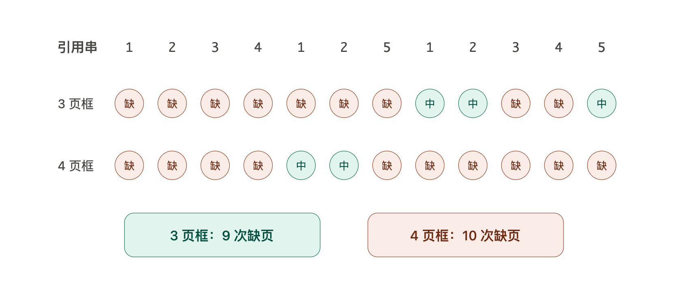
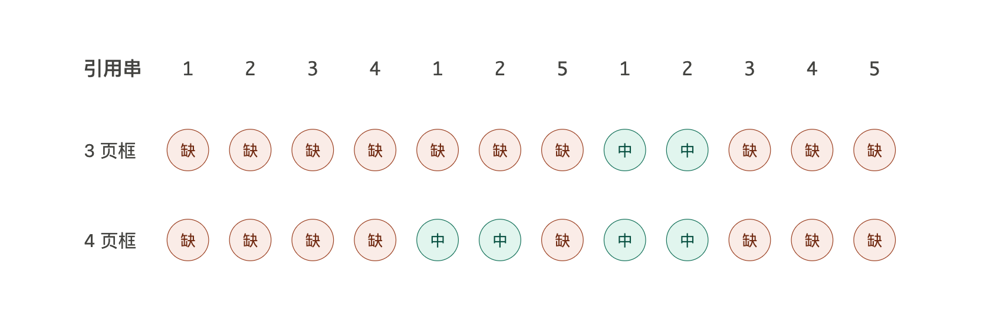

# 什么是 Belady 异常与栈特性？

在操作系统中，我们在学习内存页面置换算法的时候，会听到一个概念——“**Belady 异常**”，那具体什么事 Belady 异常呢？

简单来讲，Belady 异常是这样的：对相同的页面访问序列，使用相同的页面置换算法时，增加物理页框数量，缺页次数反而增加。当我们使用 FIFO 页面置换算法，我们来看一个例子：

这显然不是我们期望的，因为这意味着我们买个大内存条反而是没用的！但是有一种算法是不会出现 Belady 异常的，这种算法有一个共同的特性——**栈特性**。

栈特性的定义是：对同一段页面访问序列，在任意时刻，分配 n 个页框时驻留的页面集合，一定是分配 n+1 个页框时驻留页面集合的子集。简单来说，**买个大内存条肯定是有用的！**

用同样的页面引用序列，但是使用具有栈特性的 LRU 算法，举个例子：

注：不是说不具有栈特性的算法都会遭遇 Belady 异常的问题，Belady 异常只有在特定条件才会触发。